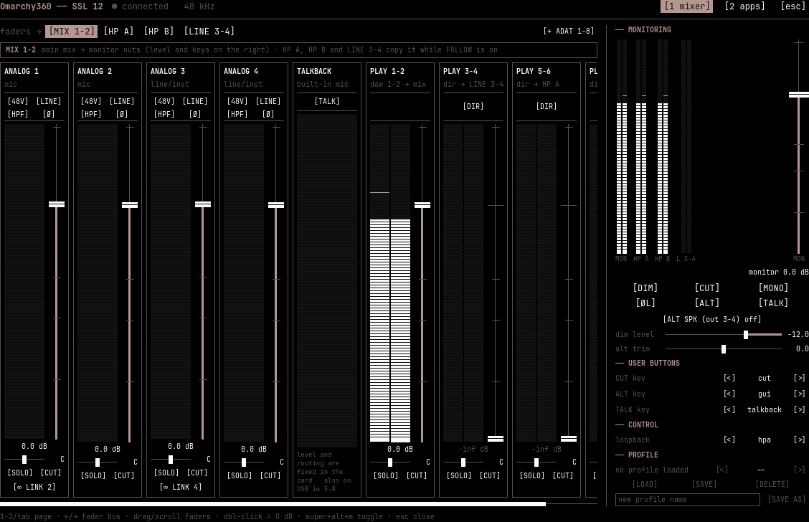

# Omarchy360 for SSL 12

A terminal-style mixer for the **Solid State Logic SSL 12** USB audio interface,
built as an [Omarchy](https://omarchy.org) shell plugin.

On Windows and macOS the SSL 12's internal mixer, monitor section and button
assignments are set with the vendor's control app. Linux has no such app.
Omarchy360 fills that gap. It adds a bar icon (or a keyboard shortcut, or a
button on the card itself) that opens a full mixer for the card, drawn in your
Omarchy theme's colours and font.



> Omarchy360 is an independent, unofficial project. It is not affiliated with,
> endorsed by or supported by Solid State Logic. "SSL" and "SSL 12" are used
> only to identify the hardware it works with.

## Contents

- [How it works](#how-it-works)
- [Features](#features)
- [Status and compatibility](#status-and-compatibility)
- [Requirements](#requirements)
- [Installation](#installation)
- [Using the mixer](#using-the-mixer)
- [Keyboard and mouse](#keyboard-and-mouse)
- [What it runs, and permissions](#what-it-runs-and-permissions)
  - [Privileged and system steps](#privileged-and-system-steps-manual-one-time)
- [Updating and uninstalling](#updating-and-uninstalling)
- [Troubleshooting](#troubleshooting)
- [FAQ](#faq)
- [Development](#development)
- [Credits and license](#credits-and-license)

## How it works

```
 SSL 12 ──USB── douze (user service) ──HTTP 127.0.0.1:1212── Omarchy360 (shell plugin)
                 owns the card:                               draws the mixer, sends
                 handshake, keepalive,                        commands, shows meters
                 state, meters, buttons
```

The SSL 12 keeps its mixer in the card, but it forgets everything at power-off
and only talks once a host has done a handshake. That job belongs to
[douze](https://github.com/xenicle/douze), an open-source, reverse-engineered
daemon for the SSL 12's USB control interface. It owns the USB connection,
keeps the mixer state on disk and pushes it back whenever the card reappears.

Omarchy360 is a front end for douze's local HTTP API. It never touches USB
itself. It can still show the page when douze is down; it just tells you so.

Audio itself does not go through any of this: PipeWire plays and records as
usual. The **apps** page talks to PipeWire directly.

## Features

### Mixer page (tab 1)

- **Input strips**: Analog 1–4, each with **48V**, **LINE** (instrument/line),
  **HPF** and **Ø** (polarity) keys.
- **Talkback strip**: the built-in talkback mic's meter and the **TALK** key.
- **Playback strips**: Playback 1-2 (the computer's main output) and Playback
  3-4, 5-6, 7-8, each with a **DIR** key that sends it straight to its own output
  (Line 3-4, HP A, HP B).
- On every strip: the card's own peak meter with a 1.5 s hold, a fader from −∞
  to +12 dB, pan, **SOLO** and **CUT**.
- **Stereo link**: join Analog 1-2 or 3-4 (or an ADAT pair) into one stereo
  strip with one fader, one pan, and shared SOLO, CUT and sends.
- **Cue mixes**: HP A, HP B and Line 3-4 each have their own mix. Pick a bus at
  the top and the faders become that bus's sends, each with its own **pan**.
  The **AUX bar** sets the bus's
  **FOLLOW MIX 1-2**, **CUT**, **MONO** and level. Line 3-4 are two mono outputs,
  so **OUT 3** and **OUT 4** each get their own FOLLOW and level.
- **Monitor section**: Monitor / HP A / HP B / Line 3-4 meters, monitor level,
  **DIM**, **CUT**, **MONO**, **ØL** (invert left), **ALT**, **TALK**,
  **ALT SPK** (outputs 3-4 as alternate speakers), dim level and ALT trim.
- **USER buttons**: assign the front-panel **CUT**, **ALT** and **TALK** keys to
  dim, cut, mono-sum, alt, invert-l, talkback, or **gui** (opens this mixer).
- **Loopback**: choose which mix is recorded back into the computer.
- **Profiles**: load, save, save as and delete complete setups.
- **ADAT 1–8**: optical input strips, hidden until you press `+ ADAT 1-8`
  (experimental, see below).
- Presses on the card's own buttons show up instantly.

### Apps page (tab 2)

Every app that is playing or recording, with its volume (0–150 %), mute and live
peak meters. For playing apps you can also pick the **output**: the SSL 12's
speakers, line 3-4, HP A or HP B, or any other sound device. For example,
Spotify only on the second pair of headphones. Volume, mute and meters work
with any sound card; the SSL output choices need douze's stereo outputs (see
[Installation](#installation)).

### Opening the mixer

- the three-fader icon in the bar (click again to close);
- a keyboard shortcut you bind (see [Installation](#3-a-keyboard-shortcut-optional));
- a front-panel button on the SSL 12 set to **gui**.

## Status and compatibility

**Only the SSL 12 is supported.** douze's protocol was decoded from the SSL 12;
other SSL interfaces use different hardware and are not supported. The SSL 2
and 2+ family have no software mixer at all.

Tested on one SSL 12 at firmware **1.41**, with Omarchy (Quickshell 0.3.2) and
PipeWire 1.6. douze itself was developed on firmware 1.44.

| Area | Status |
| --- | --- |
| Strips, preamp keys, monitor section, USER mapping, loopback, profiles, meters | tested |
| Cue-mix sends, FOLLOW / CUT / MONO, stereo link | tested |
| Talkback meter, front-panel **gui** button | tested on firmware 1.41 only |
| ADAT 1–8 | **experimental**: douze's presumed mixer slots, never tested with an optical source |
| Talkback level and routing | not adjustable: they live in the card's firmware (the vendor app's talkback trim sends nothing to the card either) |

Your firmware version is the `bcdDevice` of USB device `31e9:0005`
(`cat /sys/bus/usb/devices/*/bcdDevice` next to `idProduct` `0005`).

## Requirements

- **Omarchy** with its Quickshell-based shell (the "Quattro" shell).
- An **SSL 12** on the **Pro Audio** profile in PipeWire. Check with
  `pactl list cards short`, or switch it in the Omarchy audio panel /
  `pavucontrol` → Configuration.
- **douze** with the extensions this plugin uses (`bus_modes`, `ui`, `gui`,
  `adat`, `line4`, `send_pan`). They have been proposed upstream in
  [xenicle/douze#1](https://github.com/xenicle/douze/pull/1). Until they are merged,
  install the `omarchy360` branch of
  [FenrirRhogar/douze](https://github.com/FenrirRhogar/douze/tree/omarchy360).
  With a stock douze the plugin still works, minus stereo link, ADAT,
  FOLLOW / CUT / MONO and the **gui** button, which it hides.
- `python` and `python-pyusb` (for douze), `curl`, `pactl` (`libpulse`), and
  the PipeWire tools `pw-record`, `pw-link` and `pw-dump` (Arch: `pipewire` and
  `pipewire-audio`). All but pyusb are present on Omarchy.
- For per-app outputs on the SSL 12: douze's **stereo outputs** for the playback
  pairs (step 1 of [Installation](#installation)).

## Installation

### 1. douze

Install its only dependency and fetch it:

```bash
sudo pacman -S --needed python-pyusb curl
git clone -b omarchy360 https://github.com/FenrirRhogar/douze ~/.local/share/douze
```

**Allow your user to open the card's control interface.** douze ships a udev
rule that uses the `audio` group. The rule below instead grants access to
whoever is logged in at the seat, so no group change or re-login is needed:

```bash
echo 'SUBSYSTEM=="usb", ATTRS{idVendor}=="31e9", ATTRS{idProduct}=="0024", TAG+="uaccess"' \
  | sudo tee /etc/udev/rules.d/70-douze.rules
sudo udevadm control --reload
sudo udevadm trigger --action=change --subsystem-match=usb
```

Unplug and replug the SSL 12 if `getfacl /dev/bus/usb/*/*` does not list your
user on its device afterwards.

**Run douze as a user service**, started with your session:

```bash
mkdir -p ~/.config/systemd/user
sed "s|%h/douze|%h/.local/share/douze|" ~/.local/share/douze/systemd/douze.service \
  > ~/.config/systemd/user/douze.service
systemctl --user daemon-reload
systemctl --user enable --now douze
journalctl --user -u douze -n 5     # expect "SSL 12 branchée" and "état restauré sur le device"
```

> **The first start sets the card's mixer.** The card boots blank, and douze
> pushes its saved state on every start. On first start that is douze's default:
> Analog 1–4 and Playback 1-2 at 0 dB in the main mix, Playback 3-8 off, monitor
> and headphone levels untouched. If you monitor an instrument through a DAW,
> pull the Analog faders down so you don't hear the dry signal too.

**Stereo outputs for per-app routing** (optional, needed for the apps page's
SSL output picker). douze ships a PipeWire configuration that adds four stereo
outputs, `ssl12.pb12` … `ssl12.pb78`, one per playback pair. Install it, then
restart PipeWire and douze. The PipeWire restart cuts audio in every app for a
second or two, so close your DAW first:

```bash
~/.local/share/douze/tools/install-pipewire.sh
systemctl --user restart pipewire pipewire-pulse wireplumber
systemctl --user restart douze      # links the new outputs to the card
```

The script also installs a WirePlumber rule that keeps the card from
suspending (no crackle on the first sound after silence). Your existing devices
and per-app volumes are unchanged.

### 2. The plugin

```bash
omarchy plugin add https://github.com/FenrirRhogar/omarchy360 --enable
```

The three-fader icon appears on the right of the bar. Move it with
`omarchy bar move fenrirrhogar.omarchy360 --section <left|center|right>`.

### 3. A keyboard shortcut (optional)

Add to `~/.config/hypr/bindings.lua` (pick any free key; check with
`omarchy menu keybindings --print`):

```lua
o.bind("SUPER + ALT + M", "Omarchy360 mixer", "omarchy-shell shell toggle fenrirrhogar.omarchy360")
```

### 4. Open the mixer from the card (optional)

In the mixer, set one of the USER buttons (CUT, ALT or TALK key) to **gui**.
Then tell douze what to run when that button is pressed. douze reads this from
its service environment, never from its API:

```bash
mkdir -p ~/.config/systemd/user/douze.service.d
printf '%s\n' '[Service]' \
  'Environment="DOUZE_GUI_CMD=omarchy-shell shell toggle fenrirrhogar.omarchy360"' \
  > ~/.config/systemd/user/douze.service.d/omarchy360.conf
systemctl --user daemon-reload
systemctl --user restart douze
systemctl --user show douze -p Environment    # should list DOUZE_GUI_CMD
```

The button you pick loses its original function (for example, ALT no longer
switches speakers).

## Using the mixer

### Header

`● connected 48 kHz` means douze is running and the card is present. Otherwise
the header says **douze offline** or **SSL 12 not connected**, and the footer
says what to do. If the card and the computer disagree on the sample rate, a
**clock mismatch** warning appears. Errors from douze appear at the end of the
header.

### Strips

- **Fader**: drag, scroll (±0.5 dB per notch), or double-click for 0 dB. The
  readout below shows the exact value; the bottom of the travel is −∞ (off).
- **Pan**: drag the small slider; double-click centres it.
- **SOLO / CUT**: like a console. SOLO plays only the soloed strips in the main
  mix; CUT silences a strip.
- **Preamp keys**: 48V is red when on. Never send phantom power to ribbon
  microphones.
- **DIR** (Playback 3-4 / 5-6 / 7-8): sends that playback pair straight to its
  output (Line 3-4, HP A, HP B), bypassing the mixer. Playback 1-2 has no DIR: it
  always goes through the main mix.
- **∞ LINK / ∞ UNLINK**: under Analog 1 and 3 (and odd ADAT strips). Linking
  copies the left strip's fader, CUT and SOLO to the right one and pans them
  hard left/right. The linked strip's pan then moves the stereo image. Unlinking
  centres both.

When the strips do not fit, a scroll bar appears under them; drag it or scroll
sideways.

### The SSL 12's outputs, playbacks and DIR

The card has 8 analogue output channels, each fed by one layer of its internal
mixer:

| Outputs | Jack | Mix | Front-panel control |
| --- | --- | --- | --- |
| 1-2 | Monitor L/R | MIX 1-2 (main mix) | monitor knob, DIM / CUT / MONO / ALT |
| 3, 4 | Line out 3, Line out 4 | LINE 3-4 cue mix (two mono outputs) | none |
| 5-6 | Headphones A | HP A cue mix | HP A knob |
| 7-8 | Headphones B | HP B cue mix | HP B knob |

**Playbacks** are the 8 channels the computer plays into the card over USB,
in pairs. In PipeWire they're the SSL 12 Pro output's channels 1–8 (AUX0–7).
Playback 1-2 is where apps play by default. 3-4, 5-6 and 7-8 only carry sound
when an app or your DAW sends audio to those channels, for example a Reaper
track routed to outputs 5-6. Inside the card, every playback pair is one more
source in the mixer, like the analogue inputs, with its own strip.

**DIR** ("direct") on Playback 3-4, 5-6 or 7-8 skips the mixer and sends that
pair 1:1 to its own output: 3-4 → Line 3-4, 5-6 → HP A, 7-8 → HP B. Use it
when the computer should fully control that output, for example a separate
click and backing mix for a performer's headphones made in your DAW. Without
DIR, the pair is just another strip you can mix anywhere. Playback 1-2 has no
DIR: it always goes through the main mix.

An output with **FOLLOW MIX 1-2** on copies the main mix and ignores everything
else, DIR included. So turning DIR on also turns FOLLOW off for that output,
and turning DIR off turns it back on. While DIR is on, that output plays only
its playback pair: no main mix, no mics.

Every output can therefore carry its own mix: the main mix on 1-2, a cue mix
(sends with pan) on 3, 4, 5-6 and 7-8, or the computer's own audio via DIR.

### Cue mixes: MIX 1-2, HP A, HP B, LINE 3-4

The row `faders → [MIX 1-2] [HP A] [HP B] [LINE 3-4]` chooses what the faders
edit:

- **MIX 1-2** is the main mix to the monitor outputs. This is what you normally
  hear.
- **HP A / HP B / LINE 3-4** each have a separate cue mix. With one selected,
  each strip's fader is how loud that source is in this bus's mix, its pan
  slider places it left/right (or on output 3/4), and the button under it
  (**ON HP A / OFF HP A**, …) switches the source in or out of that mix.
  Playback strips work the same, for example a click track from your DAW on
  Playback 3-4 pushed up only in HP A. A playback pair's strip shows the
  computer's channels, not the output: PLAY 5-6 on the HP A view is "how much
  of computer channels 5-6 goes into HP A". With DIR on, that strip is locked
  on its own bus's view and reads *DIR → HP A*, because DIR already sends the
  pair there at 0 dB. On LINE 3-4
  the pan ends read **3** and **4**: hard left feeds only output 3, hard right
  only output 4.

The **AUX bar** under the row controls the selected bus:

- **FOLLOW MIX 1-2**: the bus copies the main mix and ignores its own sends.
  Its strips are then locked and read *follows MIX 1-2*. Turn FOLLOW off to build a separate headphone
  mix, for example more click and less guitar for a performer.
- **CUT** and **MONO** mute or mono-sum that output only.
- **level**: the bus output level (−60 … +12 dB).
- On **LINE 3-4** the bar has two rows, **OUT 3** and **OUT 4**, each with its
  own FOLLOW and level: the card treats outputs 3 and 4 as separate mono
  outputs. For example, OUT 3 can follow the main mix (left side) while OUT 4
  plays its own cue mix (the right-side sends). CUT and MONO act on the pair.

### Monitoring column

- The four meter pairs show what reaches the Monitor, HP A, HP B and Line 3-4
  outputs.
- The tall **MON** fader is the monitor output level. It shows *(not set)*
  until you first move it; until then the card keeps its own level.
- **DIM** lowers the monitors by the **dim level**. **CUT** mutes them. **MONO**
  sums them to mono. **ØL** inverts the left channel's polarity (a phase check).
  **ALT** switches to the alternate speakers on outputs 3-4, which only works
  with **ALT SPK** on, trimmed by **ALT trim**. **TALK** opens the talkback mic
  (the card dims the monitors while it is on).
- **USER BUTTONS**: `<` / `>` cycle the function of each front-panel key.
- **CONTROL → loopback**: which mix the card sends back to the computer as an
  extra stereo input (inputs 7-8 of the SSL 12 Pro capture device on the tested
  card). Useful for streaming or recording a call. *none* turns it off.
- **PROFILE**: `< >` picks a profile. **LOAD** applies it to the card (faders,
  sends, bus modes, preamp keys, button mapping, links). **SAVE** overwrites it.
  Type a name and press Enter or **SAVE AS** to create one. **DELETE** asks
  **SURE?** (or **NO**), and cancels by itself after 4 s. A `*` after *loaded:*
  means you changed something since loading. Profiles are douze's JSON files in
  `~/.config/sslctl/profiles/`.

### Apps page

One strip per app stream. The fader is the app's PipeWire volume (the mark is
100 %, max 150 %); scroll or drag, and double-click for 100 %. **mute** mutes
the app. Meters read in dBFS.

Playing apps have an output row, `< → speakers >`. The arrows step through:

- **speakers**: the SSL 12's Playback 1-2, the main mix (the normal place);
- **line 3-4**, **HP A**, **HP B**: the SSL 12's other playback pairs. Picking
  one also turns that pair's **DIR** on, so the app comes out of that output
  only (see [DIR](#the-ssl-12s-outputs-playbacks-and-dir)). Example: Spotify on
  **HP B** plays only in the second headphones, and HP B no longer carries the
  main mix;
- your other sound devices (HDMI, laptop speakers, …).

WirePlumber remembers the choice per app, so Spotify goes back to HP B the next
time it starts. To undo it, pick **speakers** again, and switch DIR off on that
playback strip if you want the output to follow the main mix again.

## Keyboard and mouse

| Key | Action |
| --- | --- |
| `1` / `2`, Tab / Shift+Tab | mixer / apps page |
| ← / → | previous / next fader bus (mixer page) |
| Esc | close (or leave the profile name field) |
| Enter (in the name field) | save as a new profile |

| Mouse | Fader | Slider (pan, levels) |
| --- | --- | --- |
| drag | set level | set value |
| scroll | ±0.5 dB | ± one step |
| double-click | 0 dB | reset (centre / default) |

Clicking outside the window closes it.

## What it runs, and permissions

Omarchy plugins run inside the shell process, unsandboxed, with your user's
permissions. Omarchy360 needs no root, starts no second shell, and:

- talks to douze over HTTP on `127.0.0.1:1212` only. Requests go through
  Quickshell; the live event stream runs through `curl`.
- runs `bin/omarchy360-route` (Python) on the apps page: every 2 s it lists
  outputs and app streams with `pactl`, and it moves an app with
  `pactl move-sink-input` when you pick an output;
- runs `bin/omarchy360-peaks` (Python) for the meters Quickshell can't read: the
  SSL 12's pro-audio channels, and app streams with unknown channel positions,
  such as Spotify. It records with `pw-record` (nodes named `omarchy360-meter…`),
  reads ports with `pw-dump` and, for app streams, connects them to its capture
  with `pw-link`. It only listens and never changes what an app plays. These
  processes run only while the mixer is open, and they exit with it.
- Only douze touches USB. douze's API has no authentication and listens on
  localhost, so any program running as you can change the card's mixer. That is
  douze's design.

### Privileged and system steps (manual, one time)

The plugin's code never calls `sudo`, a package manager or `systemctl`.
Every such step is in this README for you to run yourself, once:

| Step | Command | Why |
| --- | --- | --- |
| Install douze's dependency | `sudo pacman -S --needed python-pyusb curl` | douze talks USB through pyusb; the plugin's event stream uses curl |
| udev rule (root-owned file) | `sudo tee /etc/udev/rules.d/70-douze.rules` | lets your own user open the card's control interface, so douze runs without root |
| Apply the rule | `sudo udevadm control --reload`, `sudo udevadm trigger …` | makes the rule take effect without a reboot |
| douze user service | `systemctl --user daemon-reload / enable --now / restart douze` | runs douze in your session, as your user, not as root |
| Optional gui button | drop-in under `~/.config/systemd/user/douze.service.d/` | tells douze which command a front-panel button runs |
| Uninstall | `sudo rm /etc/udev/rules.d/70-douze.rules`, `systemctl --user disable --now douze` | undoes the above |

Nothing runs as root at any point after setup, and only the udev rule is
system-wide. It matches the SSL 12's control interface (USB `31e9:0024`) and
nothing else.

## Updating and uninstalling

```bash
omarchy plugin update fenrirrhogar.omarchy360      # update the plugin
git -C ~/.local/share/douze pull                   # update douze
systemctl --user restart douze
```

Uninstall:

```bash
omarchy plugin remove fenrirrhogar.omarchy360
systemctl --user disable --now douze
rm -r ~/.config/systemd/user/douze.service ~/.config/systemd/user/douze.service.d
sudo rm /etc/udev/rules.d/70-douze.rules
# douze's saved state and profiles: ~/.config/sslctl/
```

Remove the keyboard binding from `~/.config/hypr/bindings.lua` if you added
one. The card keeps its current mixer until it is powered off.

## Troubleshooting

**"douze offline"**: the daemon isn't running.
`systemctl --user status douze`, then `journalctl --user -u douze -b`. A
`USBError: Access denied` means the udev rule isn't applied: replug the card.

**"SSL 12 not connected"**: douze runs but can't see the card. Check it's on
and plugged in; on a hub, try a direct port.

**No sound from the computer**: check the **PLAY 1-2** fader (it carries the
computer's main output) and the **MON** level, then **CUT** / **DIM** in the
monitor column and on the strips. They're saved in douze's state and restored
on every start.

**One output is silent**: check that bus's **CUT** and level in the AUX bar,
and whether **FOLLOW MIX 1-2** is what you expect.

**Meters don't move**: they need douze connected (mixer page) or PipeWire (apps
page). Analog meters only move with signal on that input.

**An app shows no meter**: some apps report channel positions PipeWire can't
name; Omarchy360 meters those through `pw-record` + `pw-link`. If one still
doesn't move, check `pw-link -l` for a link from the app to `omarchy360-meter-…`.

**The apps page has no speakers / line 3-4 / HP A / HP B choices**: douze's
stereo outputs aren't installed (`pactl list short sinks | grep ssl12`); see
[Installation](#installation). An app with no output row isn't playing.

**DIR does nothing**: with an older plugin, FOLLOW MIX 1-2 on that output
overrode it. Switch DIR off and on again, or turn FOLLOW off on that output.

**FOLLOW / CUT / MONO, ∞ LINK, ADAT or the gui function are missing**: your
douze doesn't announce those extensions. Install the `omarchy360` branch (see
[Requirements](#requirements)).

**The gui button does nothing**: check that the button is set to **gui** in
USER BUTTONS and that `systemctl --user show douze -p Environment` lists
`DOUZE_GUI_CMD`. After editing the drop-in, run `systemctl --user daemon-reload`
before restarting.

**ALT does nothing**: ALT switches to the alternate speakers, so it needs
**ALT SPK** on (and the card doesn't report ALT presses until it is).

**Talkback is uneven or one-sided**: its routing is fixed in the card's
firmware. **MONO** on the headphone bus (AUX bar) puts it in both ears, along
with the music.

**Plugin code changes don't appear** (development): the overlay stays loaded
for speed; run `omarchy restart shell`.

To report a bug, include your firmware (`bcdDevice`), PipeWire version,
`journalctl --user -u douze -b --no-pager`, and
`qs log -p "$OMARCHY_PATH/shell" --tail 100`.

## FAQ

**Does it replace the vendor app?** For day-to-day mixing, monitoring and
button mapping on Linux, yes. Firmware updates and the vendor's own profile
files are out of scope.

**Is it safe for my card?** douze only sends sequences observed between the
vendor app and the card, with the documented exceptions (the **gui** function
value and the presumed ADAT slots). Mixer settings live in volatile memory, so a
power cycle always returns the card to its blank state.

**Does it work with the SSL 2, 2+, or SSL 18?** No. See
[Status and compatibility](#status-and-compatibility).

**Why "Omarchy360"?** It is an Omarchy take on what the vendor's control app
does: a reference, not an affiliation.

## Development

The plugin is plain QML plus one Python helper:

| File | Role |
| --- | --- |
| `manifest.json` | plugin manifest (bar widget + overlay, `keepLoaded`) |
| `Widget.qml` | bar icon; toggles the overlay |
| `MixerOverlay.qml` | full-screen overlay window, keyboard focus, close handling |
| `SslView.qml` | page layout, header, tabs, keys |
| `Douze.qml` | douze client: state, ordered command queue, event stream, `_features` |
| `Ssl.js` | the SSL 12 model: channels, buses, meter indices, fader taper |
| `SslStrip.qml`, `TalkbackStrip.qml`, `AuxBar.qml`, `MonitorSection.qml`, `ProfileBar.qml` | mixer page parts |
| `AppsPage.qml`, `NodeStrip.qml`, `PeakMeter.qml`, `Mixer.js` | apps page |
| `bin/omarchy360-route` | per-app output listing and moving (pactl) |
| `DbFader.qml`, `VolumeFader.qml`, `HSlider.qml`, `LevelMeter.qml`, `TermButton.qml`, `Term.qml` | controls and theme tokens |
| `bin/omarchy360-peaks` | PipeWire peak meter for nodes Quickshell can't meter |

Validate before committing:

```bash
omarchy plugin validate ~/.config/omarchy/plugins/fenrirrhogar.omarchy360

# qmllint needs the shell's qs.* modules on an import path:
mkdir -p /tmp/qslint/qs
ln -sfn "$OMARCHY_PATH/shell/Commons" /tmp/qslint/qs/Commons
ln -sfn "$OMARCHY_PATH/shell/Ui" /tmp/qslint/qs/Ui
/usr/lib/qt6/bin/qmllint -I /tmp/qslint ~/.config/omarchy/plugins/fenrirrhogar.omarchy360/*.qml
```

The remaining qmllint warnings come from Omarchy's own loosely typed objects
(`Style`, `Color`, the bar).

Lifecycle check (the Omarchy marketplace list):

```bash
ID=fenrirrhogar.omarchy360
omarchy-shell shell summon $ID '{}'; omarchy-shell shell hide $ID
omarchy-shell shell toggle $ID; omarchy-shell shell toggle $ID
omarchy plugin disable $ID; omarchy plugin enable $ID
omarchy restart shell
```

Before sending anything new to the card, read douze's
[CONTRIBUTING.md](https://github.com/xenicle/douze/blob/main/CONTRIBUTING.md).
Its first rule is to never send invented frames.

## Credits and license

- [douze](https://github.com/xenicle/douze) by xenicle: the SSL 12 protocol
  work and daemon this plugin depends on (AGPL-3.0; protocol docs CC0).
- [Omarchy](https://omarchy.org) and [Quickshell](https://quickshell.org).

Omarchy360 is released under the MIT License, see [LICENSE](LICENSE). douze is
a separate program under its own license and is not bundled.
